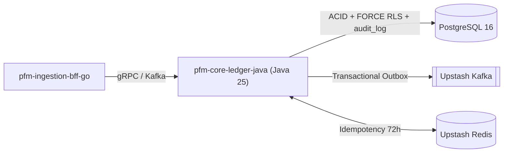

# PFM Core Ledger Service — Java 25 LTS (Hexagonal Core Banking)

[](CONTRIBUTING.md)
[](CHANGELOG.md)
[](https://sorobanerp.github.io/pfm-docs/)

---

## 1. Visão Geral & Papel na Arquitetura

Núcleo contábil ACID em **Java 25 LTS + Spring Boot 3.4 (Virtual Threads)**: partidas dobradas, Regime de Competência vs. Caixa (**RN01**), Limite vs. Orçamento (**RN02**), Estornos (**RN03**), Conciliação (**RN04**), RLS + KMS (**RN05/ADR-006**), Precisão `NUMERIC(19,4)` (**RN06**), SaaS Admin (`US-12`), Perfil/Família (`US-13`) e `audit_log` append-only (**ADR-010**).

- **Repositório:** `Sorobanerp/pfm-core-ledger-java`
- **Vínculo com `pfm-docs`:** `ADR-001, ADR-003, ADR-005, ADR-006, ADR-010 | US-01..US-05, US-10, US-12, US-13`



---

## 2. Pré-requisitos & Variáveis de Ambiente

### Pré-requisitos
- Java 25 LTS (Temurin) & Maven Wrapper (`./mvnw`)
- Docker (para Testcontainers PostgreSQL 16 RLS / Kafka / Redis)

### Variáveis de Ambiente (Sem Segredos Hardcoded)
| Variável | Padrão Local | Descrição |
| :--- | :---: | :--- |
| `SERVER_PORT` | `18200` | Porta HTTP (Actuator Health & REST) |
| `GRPC_SERVER_PORT` | `18210` | Porta gRPC do Core Ledger |
| `DB_URL` | `jdbc:postgresql://localhost:15432/pfm_core_ledger` | JDBC PostgreSQL 16 |
| `KAFKA_BOOTSTRAP_SERVERS` | `localhost:19092` | Brokers Kafka |
| `REDIS_ADDR` | `localhost:16379` | Redis / Valkey (Idempotência) |

> **Segurança (Zero-Trust):** Nunca commite tokens, senhas, chaves AWS ou strings de conexão com credenciais reais. Utilize `.env` local (ignorado no `.gitignore`) ou AWS Secrets Manager / GitHub OIDC.

---

## 3. Como Executar Localmente

```bash
# Certifique-se que local-cloud está ativo (pfm-shared-infra)
./mvnw spring-boot:run
# Healthcheck: curl -f http://localhost:18200/actuator/health
```

---

## 4. Como Testar e Validar

```bash
# Testes unitários, ArchUnit (Hexagonal) e Testcontainers (PostgreSQL 16 com FORCE RLS)
./mvnw clean verify
# Cobertura JaCoCo >= 95% validada no SonarCloud
```

---

## 5. Como Provisionar / Validar na Nuvem

1. Fluxo Gitflow: `feat/*` $\rightarrow$ `develop` $\rightarrow$ `release/vX.Y.Z` $\rightarrow$ `main` (GMUD).
2. O pipeline `cd-aws-deploy.yml` constrói imagem OCI Distroless `linux/arm64` e atualiza o serviço ECS via `pfm-core-ledger-infra`.

Consulte [CONTRIBUTING.md](CONTRIBUTING.md) para regras de Conventional Commits e [CHANGELOG.md](CHANGELOG.md) para histórico de versões.
